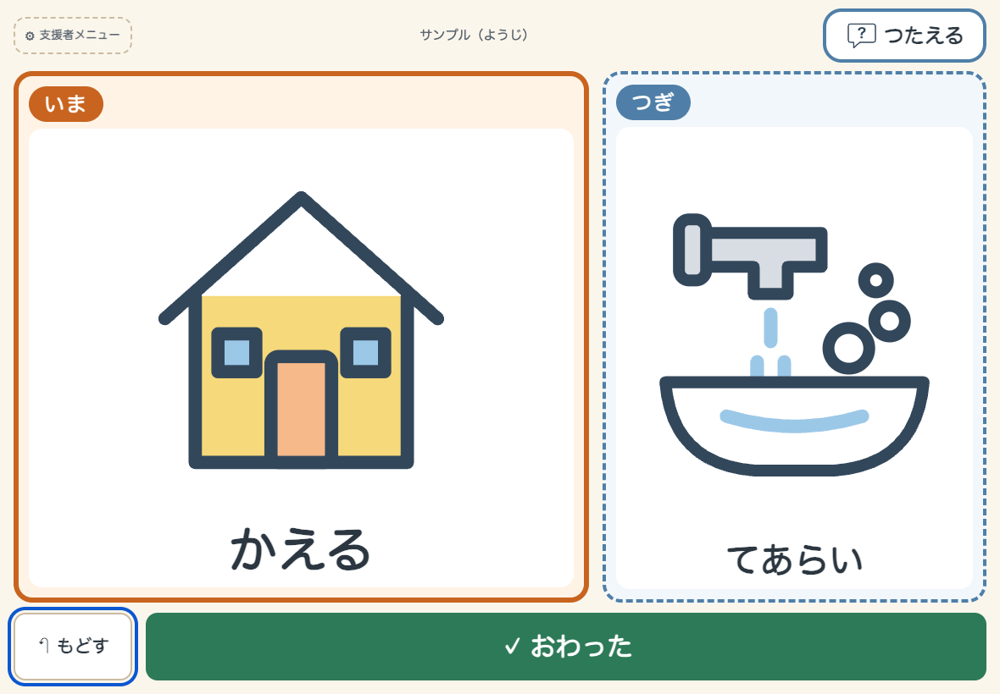

# いま・つぎ／つたえるボード

予定の見通し（**いま・つぎ**）と、きもち・お願い（**つたえる**）を、絵や写真のカードで伝えるための無料Webアプリです。
未就学児から小学生まで、子どもの理解や操作に合わせて調整して使えます。

- すぐ使う：https://robse.jp/tools/imatsugi/app/
- 紹介ページ・ダウンロード：https://robse.jp/tools/imatsugi/
- 使い方：[docs/使い方.md](docs/使い方.md)



## 特長

- **いま・つぎ**：今と次の活動を大きく表示。「おわった」で進み、押し間違いは「もどす」で戻せる。自動進行・時間制限なし
- **つたえる**：やすみたい・てつだって・いや・もういっかい・トイレ・おみず など。押すと大きく表示し、声を出さなくても見せて伝えられる
- **写真の差し替え**：端末で縮小・切り抜き・再保存（Exif・位置情報は残さない）
- **子どもに合わせた調整**：カード2/4/6枚、絵と文字／文字だけ、文字3段階、ひらがな／漢字まじり、配色4種、雰囲気2種、読み上げ（初期は無音）
- **印刷**：同じカードをA4に（10cm角・6cm角、「いま・つぎ」台紙つき）
- **プライバシー**：データは端末のブラウザ（IndexedDB）だけに保存。外部送信・解析・広告・登録なし。写真込みのバックアップ・復元

診断・治療・発達の評価を行うものではなく、療育の効果を保証するものではありません。

## 構成

ビルド不要の静的サイトです（外部ライブラリ・外部フォントなし）。`app/` をそのままHTTPSのWebサーバーに置けば動きます。

| 場所 | 内容 |
|---|---|
| `app/` | アプリ本体（`index.html`・`css/`・`js/`・`assets/`・Service Worker） |
| `tools/build.py` | `app/precache-list.js`（オフライン用のファイル一覧）の更新と配布ZIPの作成 |
| `tools/e2e.mjs` | ヘッドレスChromeでの自動検証（28項目） |
| `tools/layout-check.js` | 画面のはみ出し検査（ブラウザのコンソールで実行） |
| `tools/make_pictograms.py` | シンプルな絵（SVG）の生成元 |

`app/` のファイルを変えたら `python3 tools/build.py` を実行してください（オフライン保存の版が更新されます）。

## ローカルで動かす

```
python3 -m http.server 8942 --bind 127.0.0.1 --directory app
```

http://localhost:8942 を開きます。`app/index.html` を直接開いても動きます（その場合オフライン保存・ホーム画面追加は無効）。

自動検証（上のサーバーを起動したまま、macOS の Google Chrome が必要）：

```
node --experimental-websocket tools/e2e.mjs
```

## 動作確認

macOS の Google Chrome で確認済み（タブレット・スマホの画面サイズは再現で確認）。
iPad・iPhone（Safari）、Android（Chrome）、Windows、Edge・Firefox の実機は未確認です。

## ライセンス

MIT License（プログラム・絵・イラストすべて）。[LICENSE](LICENSE) を参照してください。

## 提供

合同会社Robse（島根県出雲市）　https://robse.jp　company@robse.jp
お問い合わせの際、お子さんの氏名や写真は送らないでください。
