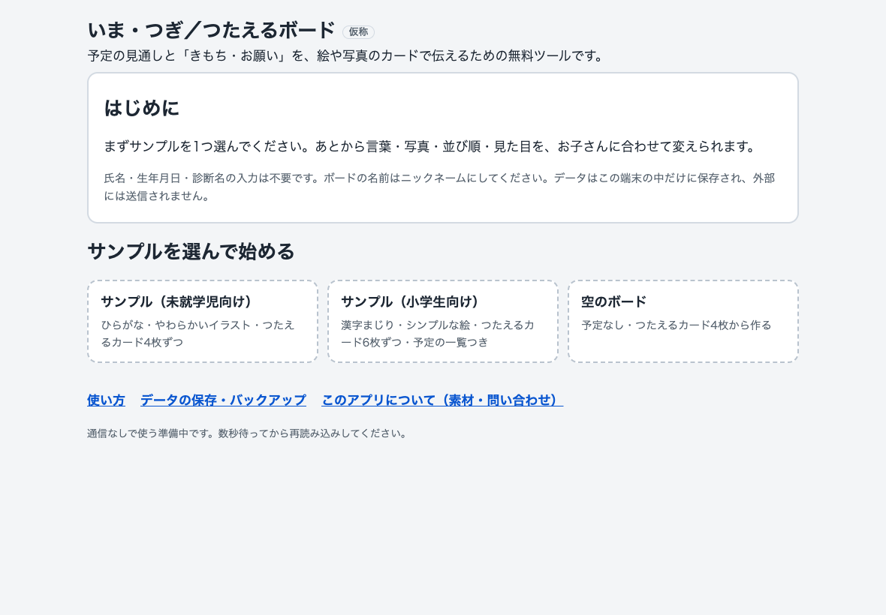
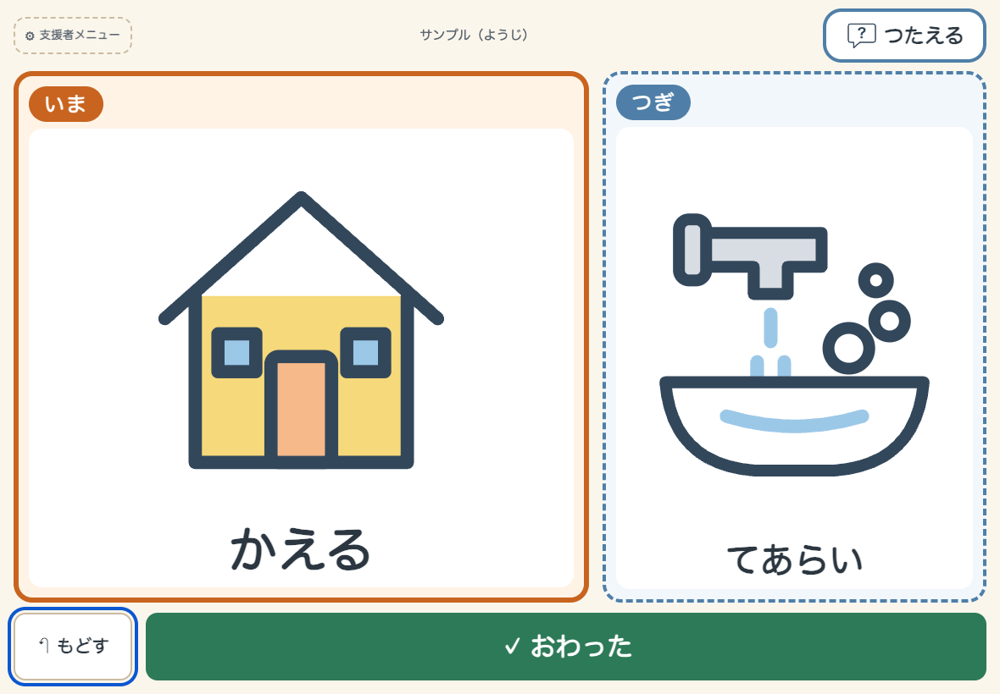
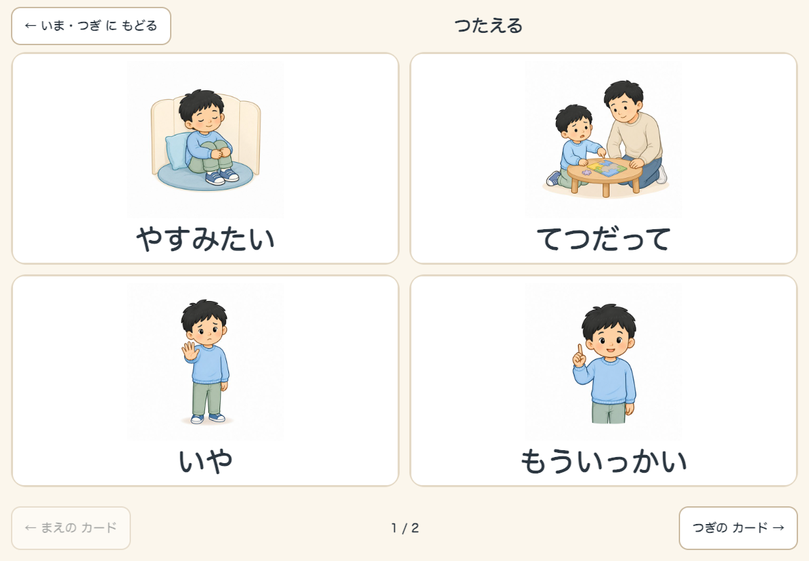
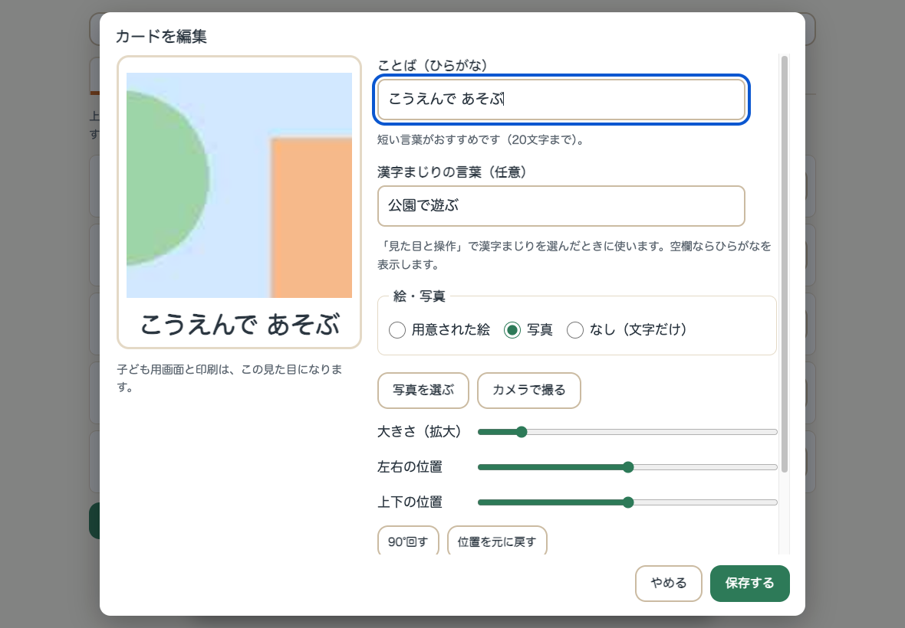

# いま・つぎ／つたえるボード（仮称）使い方

予定の見通し（いま・つぎ）と、きもち・お願いを、絵や写真のカードで伝えるための無料ツールです。
対象は未就学児から小学生まで。年齢ではなく、お子さんの理解や操作のしやすさに合わせて調整して使います。

- 利用登録・広告・課金・アクセス解析はありません。
- ボードや写真は**使っている端末のブラウザの中だけ**に保存され、外部に送信されません。
- 診断・治療・発達の評価は行いません。療育の効果を保証するものではありません。

## 1. 開く

| 使い方 | 手順 |
|---|---|
| 配布ZIPから使う | ZIPを展開し、`app` フォルダの `index.html` をブラウザ（Chrome推奨）で開く |
| 公開URLから使う | https://robse.jp/tools/imatsugi/app/ を開く（一度開けば通信なしでも開ける・ホーム画面に追加できる） |

ZIPから開いた場合も通信なしで動きます。ただし、ホーム画面への追加はできません。

## 2. 始める

1. 最初の画面で「サンプル（未就学児向け）」「サンプル（小学生向け）」「空のボード」から1つ選びます。
2. 支援者メニューが開くので、予定のカードを実際の流れに合わせて並べ、言葉や写真を変えます。
3. 「← いま・つぎ（子ども用画面）に戻る」で子ども用画面にして、お子さんと一緒に見ます。

ボードの名前はニックネームにしてください。氏名・生年月日・診断名は入力不要です。

## 3. いま・つぎ

- 「いま」する活動を大きく、「つぎ」の活動を右（縦向きでは下）に出します。
- 終わったら「おわった」で次へ進みます。押す人（子ども／おとな）は設定で選べます。
- 間違えたら「もどす」で1つ戻せます。自動で進んだり、時間で切り替わったりはしません。
- 右上の「つたえる」から、いつでも1回で「つたえる」画面を開けます。

## 4. つたえる（きもち・お願い）

- カードを押すと大きく表示されます。声を出さなくても、そのまま相手に見せて伝えられます。
- 間違えたときは「とじる」で戻れます。
- 初期のカード：やすみたい／てつだって／いや／もういっかい／トイレ／おみず（ほかに、まって・こまった・おわりたい・しずかにしたい・できた・ありがとう を追加できます）

**おとなのかたへ**：お子さんがカードを選んだら、まず「〇〇なんだね」と受け止めてください。
「やすみたい」「いや」も大切な意思表示です。予定を終えたかどうかや約束と引きかえにしないでください。

## 5. 支援者メニュー（編集）

子ども用画面の左上「支援者メニュー」を押し、表示された3つの数字を順番に押すと開きます。
お子さんが誤って編集画面に入らないための確認です（長押しは使いません）。一度入ると10分間は確認を省きます。

| タブ | できること |
|---|---|
| 予定（いま・つぎ） | カードの追加・削除・並べ替え（↑↓ボタン。パソコンではドラッグも可）、「ここをいまに」で途中から始める |
| つたえるカード | カードの追加・削除・並べ替え |
| 見た目と操作 | 下の表のとおり |
| ボード | 名前の変更、複製、削除 |

### カードの言葉と写真を変える

各カードの「編集」から、ことば（ひらがな）・漢字まじりの言葉・絵／写真を変えられます。
写真は「写真を選ぶ」または「カメラで撮る」で取り込み、大きさ・位置・向きを確かめてから保存します。
写真は端末の中で小さくして保存し直すため、撮影場所などの情報は残りません。

### お子さんに合わせる（見た目と操作）

| 項目 | 選べるもの |
|---|---|
| 「おわった」を押す人 | 子どもが押す／おとなが進める |
| つたえるカードの枚数 | 2枚／4枚／6枚（多いときは「つぎのカード」でめくる） |
| カードの表示 | 絵・写真と文字／文字だけ |
| 用意された絵の種類 | やわらかいイラスト／シンプルな絵 |
| 文字の大きさ | ふつう／大きい／とても大きい |
| 表記 | ひらがな／漢字まじり |
| 配色 | あたたかい／白／くっきり（白黒）／暗め |
| 雰囲気 | やわらかい／すっきり（小学生にも） |
| 予定の一覧 | 出さない／下に出す |
| 読み上げ | 使わない（初期）／使う（端末に日本語の音声がある場合のみ） |

まず少ない枚数・短い言葉から始め、様子を見て変えてください。

## 6. 紙で使う（印刷）

支援者メニューの「カードを印刷」から、画面と同じカードをA4に印刷できます。

- 印刷するもの：カードだけ／「いま・つぎ」の台紙つき
- 大きさ：10cm角（1枚に4つ）／6cm角（1枚に12こ）
- 点線が切り取り線です。用紙はA4縦・倍率100%（「ページに合わせる」はオフ）にしてください。
- PDFにするときは、印刷画面の送信先で「PDFに保存」を選びます。

## 7. データの保存・バックアップ

- ボードと写真は、この端末のこのブラウザの中だけに保存されます。
- 次のときは消えることがあります：ブラウザの履歴・サイトデータの消去、プライベート（シークレット）モード、端末やブラウザの変更。
- 「データの保存・バックアップ」画面で、ボードをファイルに書き出せます。**ファイルには写真が含まれます。**共有のパソコンやクラウドに置くときは、保管場所と削除に注意してください。
- バックアップから戻すと、中のボードが「追加」されます。今あるボードは上書きされません。
- 「すべて消す」は確認のチェックを入れてから実行します。元に戻せません。

## 8. 動作を確認した環境

パソコン（macOS）の Google Chrome で確認しています。タブレット・スマホの画面の大きさはパソコン上で再現して確認しました。
iPad・iPhone（Safari）、Android（Chrome）、Windows、Edge・Firefox の実機では、まだ確認していません。

## 9. ライセンス

プログラム・絵・イラストはすべて MIT License で公開しています。改変・再配布・商用利用ができます。
ソースコード：https://github.com/ohayoo37/imatsugi-board　紹介ページ：https://robse.jp/tools/imatsugi/

## 10. お問い合わせ

合同会社Robse　メール：company@robse.jp　ウェブサイト：https://robse.jp
お問い合わせの際、お子さんの氏名や写真は送らないでください。
